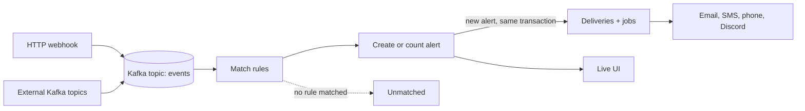
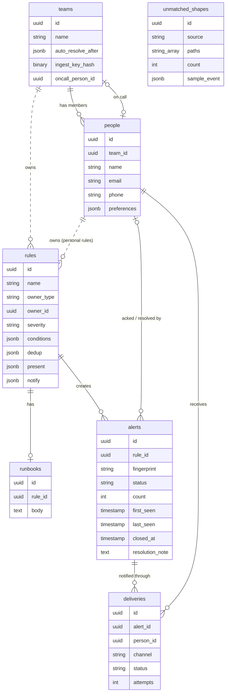

# Minion

Creators: Kamil Podolak (captain), Antoni Chmiela, Agnieszka Sarkowicz, Eryk Wójtowicz

Repo: https://github.com/minions-extra-cool/Minion-Hackathon

Minion gets the right alert to the right people on the channel they prefer, and helps them fix it. It takes events from any system in any shape, matches them against rules that teams write in the browser, folds repeats into one alert with a counter, and notifies people by email, SMS, phone or Discord. Each alert carries the team's runbook, filled in with values from the event. When someone resolves an alert, the note on how they fixed it can be folded back into the runbook.

## Quick start

You need Docker and Elixir 1.17 or newer (we use 1.19 on OTP 28). Node is only needed for the load test.

```
docker compose up -d     # Postgres, Redpanda (Kafka), Mailpit
mix setup                # dependencies, database, demo data
mix phx.server           # http://localhost:4000
```

In a second terminal, send some demo events:

```
scripts/demo_events.sh
```

Then open http://localhost:4000 and pick a person from the menu in the top bar. The demo data has two teams. Gru's Squad is Gru, Kevin (on call) and Bob, and Vector Industries is just Vector. Each person sees only their own and their team's alerts and rules, so switch between Gru and Vector to see both sides.

Things worth trying:

- Open an alert to see its runbook, who was notified and how, and acknowledge or resolve it.
- Watch SMS and phone messages arrive at http://localhost:4000/gateway, and emails at http://localhost:8025. Switch the fake gateway to "down" and the deliveries retry, then fall back to email.
- The Unmatched tab lists events that no rule caught. "Create rule" opens the editor with the event loaded in the test panel.
- Edit a rule and save it. The running pipeline picks it up straight away, without a restart.
- Send your own event: `curl -X POST localhost:4000/ingest/my-service -H "Authorization: Bearer minion-dev-gru-key" -d '{"anything": "you like"}'`

The Redpanda console at http://localhost:8080 shows the Kafka topics.

### AI features (optional)

The alert summary, "Draft with AI" in the rule editor and the runbook suggestion after resolving use Google Gemini. To turn them on, set `GEMINI_API_KEY` before starting the server. Without a key the app works as usual, and those buttons tell you that AI is not configured. We are happy to demo these features on our own machine.

## How it works



Sources wrap each message in a small envelope (id, source, time received, payload) without reading the payload, and put it on a Kafka topic. The pipeline matches every event against the enabled rules, which it keeps in memory. A rule's dedup fields give each event a fingerprint, and events with the same fingerprint add to one alert's counter. Only the first event of an alert notifies anyone. The new alert, its delivery rows and their delivery jobs are written in one database transaction, so an alert never exists without its notifications. Deliveries run as background jobs with retries. Every change is pushed to open browser tabs over a websocket, so the feed updates without a refresh.

An alert stays open until someone resolves it. An alert whose events stop for the rule's quiet time is closed, and the next event opens a fresh alert that notifies again. Teams can let quiet info and warning alerts resolve themselves. Critical alerts always need a person.

The app is written in Elixir with Phoenix LiveView for the UI. Postgres holds all state and Redpanda stands in for Kafka.

## Data model



A rule and its alerts belong to either a team or a single person. The dotted lines show that ownership: it is stored as `owner_type` plus `owner_id`, without a foreign key. Delivery jobs live in Oban's own `oban_jobs` table.

## Adding a data source

Minion has no notion of a registered schema. A source can send any JSON, or plain text, and the payload is stored as it arrives. Rules point at fields by path, such as `payload.labels.service` or `payload.errors.0.code`. So when a system you have never seen starts sending events, the only thing to add is a rule, and the Unmatched tab shows you its events so you know what to write.

Over HTTP there is nothing to deploy. Create a key for your team on its page under Teams, then post to `/ingest/<source-name>` with `Authorization: Bearer <key>`. The source name is whatever you put in the URL. A request may carry one event or a JSON array of them.

A Kafka topic is one line in `config/config.exs`:

```elixir
config :minion, :kafka_sources, [
  %{topic: "workflow-events", source: "workflow-engine"},
  %{topic: "trade-events", source: "trading-platform"}
]
```

For another kind of source, such as a tailed log file or a polled API, write a process that reads it and calls `Minion.Ingest.envelope/3` and `Minion.Ingest.publish/1`. `Minion.Ingest.KafkaSource` is a complete example in under 80 lines.

## Adding a channel

A channel is a module with two functions: `label/0` for the UI, and `deliver(alert, person)`, which returns `:ok` or `{:error, reason}`. It can also list `permanent_errors/0`, errors that should fail at once instead of retrying (a person without a phone number, say). Register it in `config/config.exs`:

```elixir
channels = [
  email: Minion.Channels.Email,
  sms: Minion.Channels.Sms,
  phone: Minion.Channels.Phone,
  discord: Minion.Channels.Discord
]
```

The rest follows from that list: the job queue, validation of rules and preferences, and the checkboxes in the UI. Retries, the email fallback and delivery status tracking work for every channel without extra code. Swapping the fake SMS gateway for a real provider means changing `Minion.Channels.Gateway` only.

## What we added beyond the brief

- Unmatched events are grouped by shape and listed in the UI, so a team sees what it is missing and can turn one into a rule in two clicks.
- The rule editor tests a rule against a real event and marks each condition as passing or failing. It can also draft a whole rule from an event with AI.
- Resolving asks how the problem was fixed, and the AI folds that answer into the rule's runbook for the team to review and save. Runbooks get better as alerts are resolved.
- The alert page offers an AI summary built from the event, the rule and the runbook.
- Several instances can run as a cluster. Kafka splits the work between them, and Postgres guarantees deduplication whichever instance sees an event.
- Teams get their own ingest keys. Only a hash of each key is stored.

## Performance

We measured throughput and latency with `scripts/load_test.mjs` on one 12-core MacBook, running everything locally in production mode. The pipeline processed about 40,000 events per second at its ceiling. At 20,000 events per second, the time from HTTP request to stored alert was 163 ms at p50 and 339 ms at p99, and nothing was lost. Under load, an email reached the mail server 1.7 s after ingest at p50 and 3.5 s at p99. Processing events in batches, one database transaction per batch, raised the ceiling about tenfold over one transaction per event.

The method, all runs, a two-instance crash test and the caveats are in [load-test-results/README.md](load-test-results/README.md).

## What is mocked

SMS and phone calls go to a fake gateway built into the app (`/gateway`). Emails go to Mailpit, a local mail catcher. Discord is real: add a webhook URL on a person's profile. There is no login. The person menu in the top bar decides whose view you see and who acknowledges an alert. Locally, Postgres and Redpanda run as single instances.

## How we used AI

- Right off the bat, we can state that we used Claude Opus 5.5 on Medium effort to generate the entirety of the code in this codebase.
- That does not mean we do not have ownership over the product.
  * We drove all of the planning sessions and used Opus 5.5 (and Fable 5.2 on High effort) as assistants and "rubber ducks". We approached their output critically and always understood it to be rough first draft around
- We adopted an iterative workflow, in which we began by scanning the task statement collaboratively and making human intelligence-only whiteboard notes.
  * After completing this, we discussed our notes with Fable and juxtaposed them against the task statement to ask for feedback.
  * Some of it was on point; in other cases it misunderstood our intention or the task statement itself (or at least it understood it differently than the four of us did.)
- LLMs were also useful for spiking and then implementing performance improvements (like the batching + clustering PR), as well as prioritizing work we would define.
